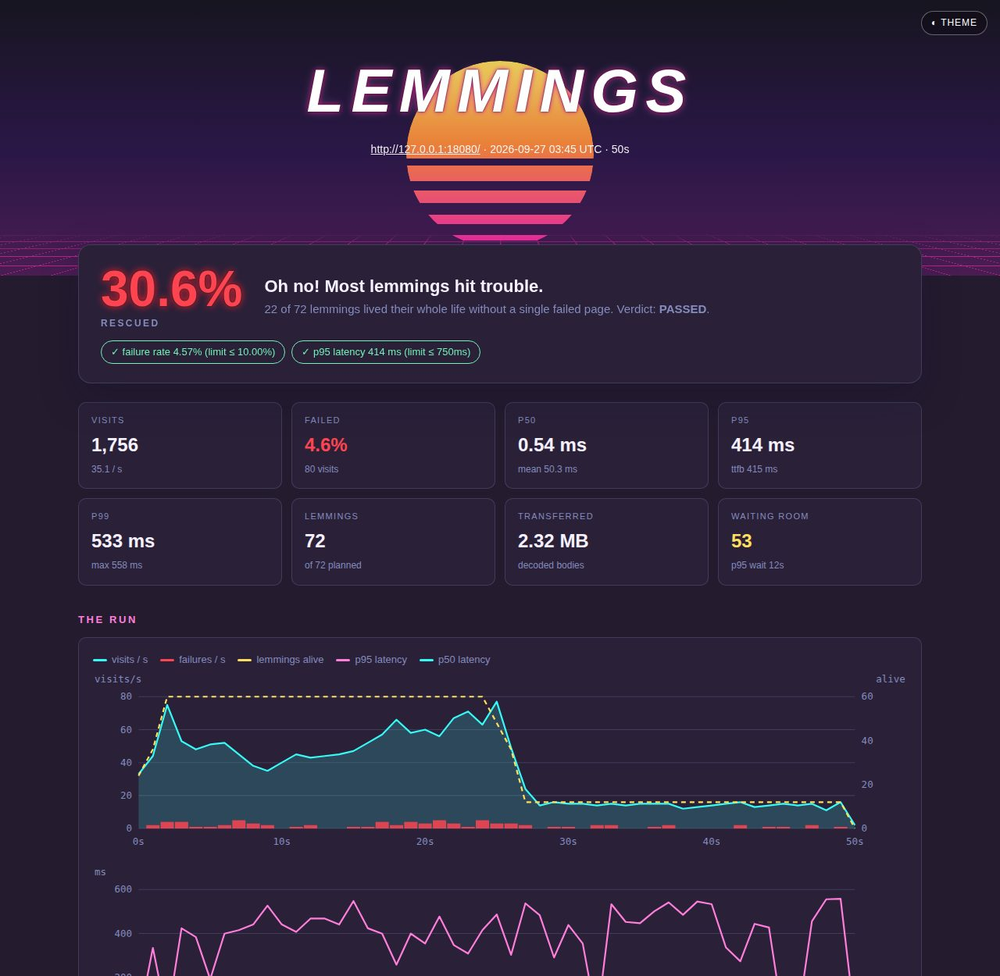

# L E M M I N G S

**Stateful load simulation with live error screenshots, JS console forensics, an Admin Triage Portal, and CI regression gates — in one zero-Node Go binary.**

[](https://go.dev/)
[](CHANGELOG.md)
[](LICENSE)

---

## Why Lemmings?

Most load testers blast stateless HTTP requests and hand you a table of response codes. When something breaks under real traffic, you are left guessing: *What did the broken page actually look like? Did the user lose their session cookie? Did a JavaScript runtime error crash a `200 OK` checkout screen?*

**Lemmings acts like a real crowd of visitors — and hands you the receipts when one hits trouble:**

- **Stateful visitors & multi-persona YAML plans.** Every lemming has a sequential number (`#1..N`), browser persona, `Accept-Language`, RFC 6265 bounded cookie jar (`InspectingJar`), dedicated connection pool, human think time, `Referer` trail, optional same-origin static asset loading (`-assets`), and native **Concert** waiting-room protocol support. Script up to **100 weighted user personas** in strict YAML (`-plan`) across `GET`, `POST`, `PUT`, `PATCH`, `DELETE`, `HEAD`, and `OPTIONS` while a configurable **5% rogue cohort** (`-rogue-rate`) wanders freely to uncover unscripted regressions.
- **Automatic 4-part Error Forensics.** Whenever a lemming hits a `4xx`/`5xx`, transport error, failed plan assertion, or JS error, Lemmings automatically captures:
  1. **Session state, cookie jar status & lemming `#number`** (cookie metadata + HMAC fingerprint; raw values redacted in reports)
  2. **JavaScript console output** (errors, uncaught exceptions, warnings, failed subresources)
  3. **Visual screenshot** (captured in pure Go over Chrome DevTools Protocol inside an isolated incognito context — **zero Node.js or Playwright required**)
  4. **Parsed & extracted error page body** (HTML, RFC-7807 JSON, XML, or plain text with secret scrubbing and safe diagnostic headers)
- **Live Admin Triage Portal.** Watch screenshots stream into the portal as failures occur, inspect every artifact in a 4-panel modal, tag findings as `Bug`, `Flaky`, `Expected`, or `Ignored` with notes, and optionally hold the portal open (`-review`) until you click **Finalize & Write Report**.
- **Real-Browser Scouts (`-scouts N`).** Run dedicated headless Chromium visitors alongside the high-scale HTTP swarm to catch pure client-side JS and rendering crashes on HTTP `200 OK` pages.
- **Reports built for humans and CI.** Generates self-contained Synthwave '84 HTML (inline screenshots), GitHub-ready Markdown (relative `.artifacts/` images), lean JSON, `lemmings compare` regression diffs, and Prometheus metrics.

---

## Watch the Swarm & Triage Errors Live

| Admin Portal — Dark Mode (Synthwave '84) | Admin Portal — Light Mode |
| :---: | :---: |
|  |  |

| Self-Contained HTML Report with Embedded Screenshots & Triage Notes |
| :---: |
|  |

---

## 60-Second Quickstart

Try Lemmings locally right now against the bundled **Neon Arcade** demo target (includes healthy pages, slow flaky `503`s, `200 OK` soft errors, a structured `500` JSON API, a client-side JS crash page, and a virtual waiting room):

```bash
# Terminal 1 — launch the loopback-only Neon Arcade demo target
make demo

# Terminal 2 — run a forensics swarm with 1 browser Scout and -review hold mode
make run-forensics

# Or walk the Neon Arcade auth plan with CI gates
make run-plan
```

Open the one-click `http://localhost:4000/#token=...` link printed in your terminal to watch lemmings traverse the site, inspect incoming error screenshots and JS console traces live, tag bugs, and click **Finalize & Write Report**.

### Install Globally

```bash
go install github.com/andreimerlescu/lemmings/v2/cmd/lemmings@latest
lemmings -version
```

---

## Common Workflows

### Pre-flight Validation (`-dry-run`)
Validate flags, YAML plan schema & `${ENV_VAR}` placeholders, probe Chromium/CDP availability, and inspect the indexed URL pool without sending load:

```bash
lemmings -hit https://staging.example.com/ -plan examples/plans/neon-arcade-personas.yaml -dry-run
```

### CI Load & Regression Gate
Run a weighted multi-persona YAML plan suite (single file, comma-separated list, or directory) with plan-pass, failure-rate, and p95 latency gates (exit code `2` on breach), then diff against your baseline release:

```bash
lemmings \
  -hit https://staging.example.com/ \
  -terrain 8 -pack 15 -limit 80 -until 60s -ramp 15s -ramp-shape fibonacci \
  -plan examples/plans/neon-arcade-personas.yaml \
  -scouts 2 \
  -min-plan-pass-rate 0.99 \
  -max-failure-rate 0.01 \
  -p95-budget 750ms \
  -tty=false \
  -unique-report \
  -save-to ./reports

lemmings compare \
  -max-failure-delta 0.01 \
  -max-p95-delta 100ms \
  -max-rescued-drop 2.0 \
  reports/baseline.json reports/candidate.json
```

### Remote Chromium Sidecar (Docker / CI)
Point Lemmings at a local loopback Chrome DevTools endpoint with zero local browser install (non-loopback endpoints fail closed unless you explicitly opt in with `-allow-remote-cdp`):

```bash
lemmings -hit https://staging.example.com/ -cdp-url http://127.0.0.1:9222 -scouts 2
```

### Concert Waiting Room & Static Asset Tier
Exercise origins fronted by [Concert](https://github.com/andreimerlescu/concert) (HTML `waiting.html`, legacy `/queue/status`, or `-api-json` HTTP `429` JSON queues) with opt-in same-origin asset loading (`-assets`) carrying each admitted visitor's `concert_admit` pass:

```bash
lemmings \
  -hit http://127.0.0.1:8081/ \
  -terrain 4 -pack 5 -limit 15 -until 30s -ramp 3s \
  -assets -assets-per-page 8 \
  -observe -save-to ./reports
```

Page latency (`-p95-budget`), asset fetches (`AssetReport`), waiting-room admission/polls (`RoomReport`), and Concert passes/bans (`ConcertReport`) are tracked and reported separately so queue wait and static assets never distort page SLOs.

If no Chrome/Chromium is available and `-cdp-url` is not set, Lemmings falls back cleanly to **HTTP-only forensics** (still capturing session state, cookie jar status, lemming `#number`, and parsed error bodies).

---

## What's Inside v2.0

| Capability | Highlights |
| --- | --- |
| **Pure-Go CDP Forensics** | Auto-detects Chrome/Chromium/Brave/Edge or connects to `-cdp-url` (loopback-only by default; `-allow-remote-cdp` opt-in); ephemeral incognito context per capture; scrubbed browser environment; screenshot grace budget; desktop & mobile viewports; deduplicated & capped (`-capture-max`, `-capture-per-error`). |
| **Concert Protocol & `-assets`** | Native Concert `waiting.html`, legacy `/queue/status`, and `-api-json` `429` JSON queue admission; separated page vs. same-origin asset tier (`-assets`, `-assets-per-page 1..64`) with per-lemming cache and `concert_admit` pass tracking. |
| **Admin Portal & `-review`** | Loopback-only (`127.0.0.1`), hash-based strict CSP, HMAC-SHA256 session cookies, per-IP (`15/min`, `1024`-IP cap) + global (`60/min`) auth limiter, CSRF protection, live SSE Error Forensics Gallery, 4-panel Inspector Modal, triage verdicts persisted into reports. |
| **YAML Plans & High-Precision Stats** | Strict `KnownFields(true)` YAML `-plan` single-file & multi-persona suites (up to 100 weighted personas, `GET`/`POST`/`PUT`/`PATCH`/`DELETE`/`HEAD`/`OPTIONS`, jar-seeded `with-cookies`, `with-headers`, form/JSON `with-body`, raw `body`, fail-closed `${ENV_VAR}` expansion, `want-status`/`want-headers`/`want-cookies`/`want-body`/HTML assertions, deterministic `-rogue-rate` 5% wanderers, `-min-plan-pass-rate` CI gate, `PlanReport`); `<= 0.5%` relative-error 4096-bin `uint64` histogram (`exactGlobalSamples = 8192`, `exactPathSamples = 1024`); `schema_version: "2.0"` JSON reports; truncated-body detection. |
| **Hardened Network & Delivery** | Dial-time `SafeDialContext` (blocks cloud metadata/link-local/unspecified/multicast) and explicit TLS 1.2+ across all clients; atomic `os.OpenRoot` local writes; validated S3 keys; TLS 1.2+ SMTP (`-smtp-pass-file` / `-smtp-pass-stdin` / env); Markdown cell & fence escaping. |
| **Observability & Supply Chain** | Isolated Prometheus `/metrics` exporter (`-observe`) with **24 metrics**, 999-URL cardinality cap, and Host-header DNS-rebinding guard; `make vulncheck`, `make sbom` (CycloneDX 1.5), and `make checksums`. |

---

## Documentation

Full end-user guides live in [`docs/`](docs/), alongside a root-level agent skill for automated persona authoring:

- **[Plans, Personas, Navigation & Page Checks](docs/plans.md)** — full YAML `-plan` specification, multi-persona weights, `-rogue-rate`, assertions, 10 ready-to-adapt persona blueprints, static asset tier (`-assets`), and Concert waiting rooms.
- **[AI Agent Skill (`SKILL.md`)](SKILL.md)** — actionable runbook enabling any coding agent to inspect a website/codebase and author 10+ distinct SEC-10-safe user-type YAML plans.
- **[Getting Started](docs/getting-started.md)** — installation, 60-second Neon Arcade walkthrough, mental model, and exit codes.
- **[Error Forensics & Screenshots](docs/error-forensics-and-screenshots.md)** — all 4 error artifacts, pure-Go CDP engine, non-GET HTTP-only safety, real-browser Scouts, redaction, and hybrid report packaging.
- **[Admin Portal & Triage Guide](docs/dashboard-guide.md)** — live gallery, 4-panel inspector modal, triage tags, `-review` hold mode, shortcuts, and API reference.
- **[Reports, Delivery & CI Gates](docs/reports-and-ci-gates.md)** — HTML/Markdown/JSON (`schema_version: "2.0"`) formats, `PlanReport`, atomic local/S3/SMTP delivery, `lemmings compare`, and GitHub Actions / GitLab CI templates.
- **[CLI Reference](docs/cli-reference.md)** — every flag, alias, default, validation range, and environment variable.
- **[Prometheus Observability](docs/prometheus-observability.md)** — all 24 metrics, cardinality protection, and PromQL queries.
- **[Architecture](docs/architecture.md)** — DDD bounded contexts (`cmd/lemmings` + 12 `internal/*` packages), package DAG, exact bounds, and backpressure pipeline.
- **[Security Posture & Audit Report](docs/security.md)** — threat model, dial-time SSRF guard, RFC 6265 cookie isolation, integrated security audit (`SEC-01`–`SEC-10`), and Chromium sandboxing.
- **[AI Agent Index (`llms.txt`)](llms.txt)** — machine-readable summary and sitemap of Lemmings capabilities, benchmarks, and guides for LLMs and coding agents.

### Comparisons & Migration Guides

Evaluating Lemmings or migrating from another load tester? See the **[Master 8-Tool Comparison Hub](docs/comparisons/README.md)** or jump straight to a side-by-side breakdown with verified real-run data, flag/script translations, and pitfalls solved out of the box:

- [Lemmings vs Apache Benchmark (`ab`)](docs/comparisons/lemmings-vs-ab.md)
- [Lemmings vs Bombardier](docs/comparisons/lemmings-vs-bombardier.md)
- [Lemmings vs NBomber](docs/comparisons/lemmings-vs-nbomber.md)
- [Lemmings vs Grafana k6](docs/comparisons/lemmings-vs-k6.md)
- [Lemmings vs Gatling](docs/comparisons/lemmings-vs-gatling.md)
- [Lemmings vs Locust](docs/comparisons/lemmings-vs-locust.md)
- [Lemmings vs Apache JMeter](docs/comparisons/lemmings-vs-jmeter.md)

---

## Development

```bash
make test         # race-enabled unit, integration, CDP, and E2E tests
make test-fuzz    # fuzz all 13 security & parser targets (incl. FuzzParsePlan, FuzzExtractAssets)
make build-check  # go vet + gofmt check + go build ./...
make vulncheck    # run govulncheck ./... across module dependencies
make build-local sbom checksums  # build bin/lemmings, bin/sbom.cdx.json, bin/SHA256SUMS
```

See [CHANGELOG.md](CHANGELOG.md) for the full v2.0.0 release notes.
