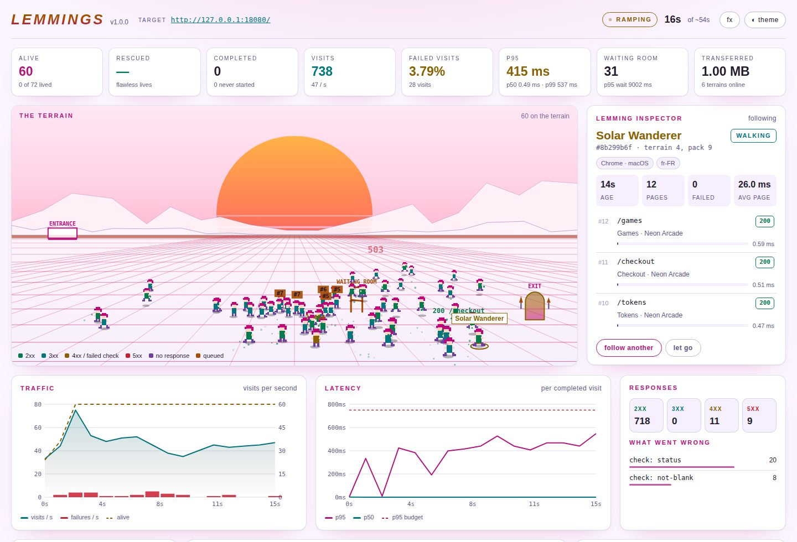

# L E M M I N G S

**Stateful load simulation with live error screenshots, JS console forensics, an Admin Triage Portal, and CI regression gates — in one zero-Node Go binary.**

[](https://go.dev/)
[](CHANGELOG.md)
[](LICENSE)

---

## Why Lemmings?

Most load testers blast stateless HTTP requests and hand you a table of response codes. When something breaks under real traffic, you are left guessing: *What did the broken page actually look like? Did the user lose their session cookie? Did a JavaScript runtime error crash a `200 OK` checkout screen?*

**Lemmings acts like a real crowd of visitors — and hands you the receipts when one hits trouble:**

- **Stateful visitors, not raw loops.** Every lemming has a sequential number (`#1..N`), browser persona, `Accept-Language`, isolated cookie jar (`InspectingJar`), dedicated connection pool, human think time, `Referer` trail, and waiting-room awareness.
- **Automatic 4-part Error Forensics.** Whenever a lemming hits a `4xx`/`5xx`, transport error, failed journey assertion, or JS error, Lemmings automatically captures:
  1. **Session state, cookie jar status & lemming `#number`** (cookie metadata + HMAC fingerprint; raw values redacted in reports)
  2. **JavaScript console output** (errors, uncaught exceptions, warnings, failed subresources)
  3. **Visual screenshot** (captured in pure Go over Chrome DevTools Protocol inside an isolated incognito context — **zero Node.js or Playwright required**)
  4. **Parsed & extracted error page body** (HTML, RFC-7807 JSON, XML, or plain text with secret scrubbing and safe diagnostic headers)
- **Live Admin Triage Portal.** Watch screenshots stream into the portal as failures occur, inspect every artifact in a 4-panel modal, tag findings as `Bug`, `Flaky`, `Expected`, or `Ignored` with notes, and optionally hold the portal open (`-review`) until you click **Finalize & Write Report**.
- **Real-Browser Scouts (`-scouts N`).** Run dedicated headless Chromium visitors alongside the high-scale HTTP swarm to catch pure client-side JS and rendering crashes on HTTP `200 OK` pages.
- **Reports built for humans and CI.** Generates self-contained Synthwave '84 HTML (inline screenshots), GitHub-ready Markdown (relative `.artifacts/` images), lean JSON, `lemmings compare` regression diffs, and Prometheus metrics.

---

## Watch the Swarm & Triage Errors Live

| Admin Portal — Dark Mode (Synthwave '84) | Admin Portal — Light Mode |
| :---: | :---: |
|  |  |

| Self-Contained HTML Report with Embedded Screenshots & Triage Notes |
| :---: |
|  |

---

## 60-Second Quickstart

Try Lemmings locally right now against the bundled **Neon Arcade** demo target (includes healthy pages, slow flaky `503`s, `200 OK` soft errors, a structured `500` JSON API, a client-side JS crash page, and a virtual waiting room):

```bash
# Terminal 1 — launch the loopback-only Neon Arcade demo target
make demo

# Terminal 2 — run a forensics swarm with 1 browser Scout and -review hold mode
make run-forensics
```

Open the one-click `http://localhost:4000/#token=...` link printed in your terminal to watch lemmings traverse the site, inspect incoming error screenshots and JS console traces live, tag bugs, and click **Finalize & Write Report**.

### Install Globally

```bash
go install github.com/andreimerlescu/lemmings/cmd/lemmings@latest
lemmings -version
```

---

## Common Workflows

### Pre-flight Validation (`-dry-run`)
Validate flags, probe Chromium/CDP availability, and inspect the indexed URL pool without sending load:

```bash
lemmings -hit https://staging.example.com/ -journey checkout.json -dry-run
```

### CI Load & Regression Gate
Run an ordered checkout journey with failure-rate and p95 latency gates (exit code `2` on breach), then diff against your baseline release:

```bash
lemmings \
  -hit https://staging.example.com/ \
  -terrain 8 -pack 15 -limit 80 -until 60s -ramp 15s -ramp-shape fibonacci \
  -journey examples/journeys/buy-tokens.json \
  -scouts 2 \
  -max-failure-rate 0.01 \
  -p95-budget 750ms \
  -tty=false \
  -unique-report \
  -save-to ./reports

lemmings compare \
  -max-failure-delta 0.01 \
  -max-p95-delta 100ms \
  -max-rescued-drop 2.0 \
  reports/baseline.json reports/candidate.json
```

### Remote Chromium Sidecar (Docker / CI)
Point Lemmings at a remote Chrome DevTools endpoint with zero local browser install:

```bash
lemmings -hit https://staging.example.com/ -cdp-url http://127.0.0.1:9222 -scouts 2
```

If no Chrome/Chromium is available and `-cdp-url` is not set, Lemmings falls back cleanly to **HTTP-only forensics** (still capturing session state, cookie jar status, lemming `#number`, and parsed error bodies).

---

## What's Inside v2.0

| Capability | Highlights |
| --- | --- |
| **Pure-Go CDP Forensics** | Auto-detects Chrome/Chromium/Brave/Edge or connects to `-cdp-url`; ephemeral incognito context per capture; scrubbed browser environment; desktop & mobile viewports; deduplicated & capped (`-capture-max`, `-capture-per-error`). |
| **Admin Portal & `-review`** | Loopback-only (`127.0.0.1`), hash-based strict CSP, HMAC-SHA256 session cookies, CSRF protection, live SSE Error Forensics Gallery, 4-panel Inspector Modal, triage verdicts persisted into reports. |
| **Journeys & Checks** | Ordered GET funnels with status, MIME, title, substring (`contains` / `not_contains`), blank-page vs. SPA detection, and simple DOM selectors (`tag`, `#id`, `.class`). |
| **Ramp Shapes** | `-ramp-shape linear`, `fibonacci` (gentle warm-up surging to peak), or `step` (4 discrete plateaus to expose capacity cliffs). |
| **Delivery Targets** | Confined local filesystem (`os.OpenRoot`), Amazon S3 (`s3://`), and hardened TLS 1.2+ SMTP (`mailto:` with `-smtp-pass-file` / `-smtp-pass-stdin` / env). |
| **Observability** | Isolated Prometheus `/metrics` exporter (`-observe`) with 17 metrics, 999-URL cardinality cap, and Host-header DNS-rebinding guard. |

---

## Documentation

Full end-user guides live in [`docs/`](docs/):

- **[Getting Started](docs/getting-started.md)** — installation, 60-second Neon Arcade walkthrough, mental model, and exit codes.
- **[Error Forensics & Screenshots](docs/error-forensics-and-screenshots.md)** — all 4 error artifacts, pure-Go CDP engine, real-browser Scouts, redaction, and hybrid report packaging.
- **[Admin Portal & Triage Guide](docs/dashboard-guide.md)** — live gallery, 4-panel inspector modal, triage tags, `-review` hold mode, shortcuts, and API reference.
- **[Journeys, Navigation & Page Checks](docs/journeys-and-checks.md)** — writing journey JSON files, soft-error detection, blank-page checks, and waiting rooms.
- **[Reports, Delivery & CI Gates](docs/reports-and-ci-gates.md)** — HTML/Markdown/JSON formats, S3 & SMTP delivery, `lemmings compare`, and GitHub Actions / GitLab CI templates.
- **[CLI Reference](docs/cli-reference.md)** — every flag, alias, default, validation range, and environment variable.
- **[Prometheus Observability](docs/prometheus-observability.md)** — all 17 metrics, cardinality protection, and PromQL queries.
- **[Architecture](docs/architecture.md)** — DDD bounded contexts (`cmd/lemmings` + 12 `internal/*` packages), package DAG, and backpressure pipeline.
- **[Security Posture & Audit Report](docs/security.md)** — threat model, integrated security audit (`SEC-01`–`SEC-10`), secret handling, and Chromium sandboxing.

---

## Development

```bash
make test         # race-enabled unit, integration, CDP, and E2E tests
make test-fuzz    # fuzz all 11 security & parser targets
make build-check  # go vet + gofmt check + go build ./...
```

See [CHANGELOG.md](CHANGELOG.md) for the full v2.0.0 release notes.
