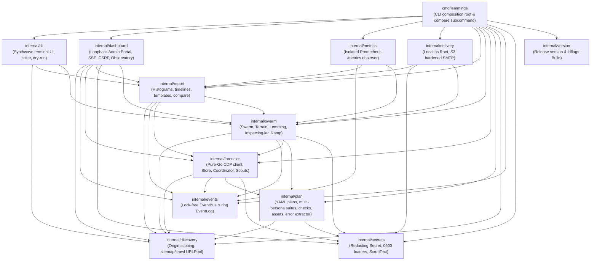
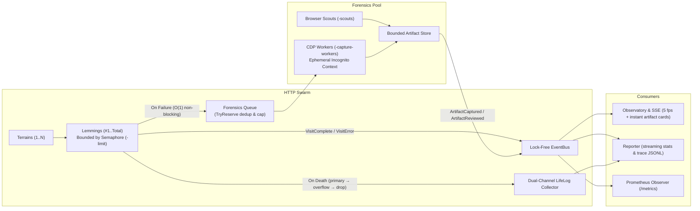

# Architecture

Lemmings v2.0 is organized into a thin composition root (`cmd/lemmings`) and 12 cohesive, acyclic bounded-context packages under `internal/`. Every cross-package dependency flows downward toward domain leaves, and all concurrency boundaries use bounded queues, explicit contexts, and clean goroutine joins.

---

## Bounded Contexts & Package DAG

### Package Responsibilities

| Package | Role |
| --- | --- |
| `cmd/lemmings` | Parses CLI flags (`figtree/v2`) and the `compare` subcommand, resolves secrets safely, wires all bounded contexts, owns graceful signal handling, and translates outcomes to exit codes (`0`/`1`/`2`/`130`). |
| `internal/version` | Holds semantic version (`v2.0.0`) overridable at link time via `-ldflags`. |
| `internal/secrets` | Provides redacting `Secret` value objects (`[REDACTED]` in `fmt`, JSON, text, `slog`), TOCTOU-safe `0600` file/env/stdin loaders, HMAC cookie fingerprinting, and `ScrubText` for untrusted bodies/console logs. |
| `internal/events` | Lock-free `atomic.Pointer`-backed `Bus` (`Emit` never blocks or allocates on the hot path), `Filter`/`Tee` combinators, and a bounded ring-buffer `Log` that strips heavy `Payload` pointers on storage. |
| `internal/discovery` | Strict scheme/host/port origin parsing (`SameOrigin`), URL credential/query stripping (`SafeURL`), dial-time network guard (`SafeDialContext`, `CheckTargetAddr`, `IsLoopbackURL`, `MinTLSConfig` TLS 1.2+), and fixed-worker-pool (`indexConcurrency = 8`) sitemap/robots/HTML crawler building a read-only `URLPool` (`BuildURLPool` automatically drops from 8 concurrent index workers to sequential 1-worker hydration with cookie-jar reuse, and halts on waiting-room responses, whenever Concert or waiting-room headers/markers are detected to avoid queue poisoning at startup). |
| `internal/plan` | Parses and validates strict YAML plans and multi-persona suites (`KnownFields(true)`, single YAML document per file, `LoadSuite` across files/directories/comma-separated specs, `-max-plan-items` with scaled read cap up to `64 MiB`, `MaxSuitePlans = 100`, fail-closed `${ENV_VAR}` expansion with `$$` escaping, deterministic weight-proportional `Suite.Pick`); inspects HTTP/HTML responses (`want-status`, `want-headers`, `want-cookies`, `want-body`, `want-content-type`, `want-title`, `want-selectors`, SPA-aware `not-blank` auto-skipped on `HEAD`/`204`/`304`/non-`2xx`, SEC-10 redaction of sensitive headers and cookies); filters non-navigable links (`/logout`, downloads, `/_concert/*`); extracts same-origin HTML/CSS subresource assets (`ExtractAssets`, `ExtractCSSAssets`, `ClassifyAsset`, `FuzzExtractAssets`); and extracts structured errors from HTML, JSON (RFC 7807), XML, and plain text. |
| `internal/forensics` | Pure-Go Chrome DevTools Protocol client over `golang.org/x/net/websocket` routed through `SafeDialContext` & `MinTLSConfig()`, fail-closed loopback-only `-cdp-url` (`-allow-remote-cdp` opt-in), hardened local Chromium launcher (scrubbed child environment + `0700` ephemeral profile), isolated per-capture incognito contexts with RFC 6265 cookie-domain filtering and screenshot grace budgets (`min(2s, timeout/4)`), `context.WithoutCancel` Ctrl-C capture draining, HTTP-only forensics fallback for failed non-GET / request-body plan steps (skipping bogus GET CDP replay), bounded async `Coordinator` worker pool, concurrency-safe `Store`, and off-origin-isolated real-browser Scouts (`events.ScoutVisit`, auto-falling back to `URLPool` if any plan has non-GET steps). |
| `internal/swarm` | Core simulation: `Config` (`-plan`, `-max-plan-items`, `-rogue-rate`, `-min-plan-pass-rate`, `-assets`, `-assets-per-page`, `-allow-remote-cdp`), `RampDelays` (`linear`/`fibonacci`/`step`), RFC 6265 / public-suffix scoped `InspectingJar` (bounded at `maxTrackedCookies = 256` with deterministic `ReplayCookies` and `HasActiveCookie`), `Terrain` (strict single-owner lifecycle accounting with distinct `LemmingsStarted`/`LemmingsCompleted`), stateful `Lemming` (deterministic rogue vs. weighted-persona assignment, multi-method YAML plan execution with jar-seeded `with-cookies`, per-step `with-headers`, form/JSON `with-body`, raw `body`, `chill`, `follow-redirects`, `stop-on-fail` exit reason `plan-failed`, Concert `waiting.html`/legacy/`-api-json` queue protocol, opt-in `-assets` tier with per-lemming 2048-entry cache, `ErrTruncatedBody` detection, cancelled visits excluded from status classes), and `Swarm`. |
| `internal/report` | High-precision latency series (`exactGlobalSamples = 8192`, `exactPathSamples = 1024`, then `<= 0.5%` relative-error 4096-bin `uint64` histogram with `histogramGrowth = 1.005`), compacted monotonic timeline, `0600` `O_EXCL` JSONL `TraceWriter`, `schema_version: "2.0"` JSON/HTML/SMTP-HTML/Markdown renderers with `PlanReport` (plan cohort pass rate, rogue cohort, per-persona ordered `PlanStepReport` tables), separated Page/Asset/Waiting-Room/Concert/Scout sections, `-min-plan-pass-rate` CI gate evaluation, `mdCell`/`mdFence` Markdown escaping, `DATA DROPPED` banners, and `Compare` regression engine. |
| `internal/delivery` | Pluggable `report.Target` adapters: `LocalTarget` using atomic temp-file + `Sync` + `Close` + `Rename` confined via `os.OpenRoot`, `S3Target` (AWS SDK v2) with strict `validateSafeComponent` path validation, and `MailTarget` (CRLF-hardened MIME + TLS 1.2+ fail-closed SMTP). |
| `internal/dashboard` | Embedded Synthwave '84 Admin Portal served exclusively on `127.0.0.1` with strict hash-based CSP, zero `innerHTML`/`outerHTML`/`document.write`, HMAC-SHA256 session cookies, per-IP (`15/min`, `1024`-IP cap) + global (`60/min`) auth limiter, `http.NewCrossOriginProtection()`, SSE streaming (including plan/rogue cohorts, assets, queue polls, bans, and scouts), and `-review` hold orchestration. |
| `internal/metrics` | Isolated `prometheus.Registry` exposing **24** `lemmings_*` metrics on loopback with Host-header DNS-rebinding protection and 999-URL cardinality capping. |
| `internal/cli` | Truecolor Synthwave terminal renderer honoring `NO_COLOR`, `-color=false`, and `-tty=false`. |

---

## Concurrency & Backpressure Pipeline

### Key Engineering Invariants

1. **Zero hot-path blocking from browser captures:** When a lemming hits a `500` or check failure, `Coordinator.Submit` performs an O(1) mutex reservation (`TryReserve`) and non-blocking channel send. If the fingerprint already hit `-capture-per-error`, the global cap `-capture-max` was reached, or the queue is full, the request is counted in drop metrics and returns immediately — HTTP load generation never stalls waiting for Chrome.
2. **Single-owner lifecycle counters:** Only `Terrain` emits `LemmingBorn`, `LemmingDied`, and `LemmingFailed` (and updates `LemmingsAlive`/`LemmingsCompleted`), guaranteeing `alive` returns to exactly `0` and never drifts or double-counts.
3. **Bounded memory at scale:**
   - The dashboard stage caps rendered sprites at `160` lemmings and batches events at `5 fps`, keeping browser CPU flat from `10` to `100,000` lemmings.
   - Latency uses exact sorted samples up to `exactGlobalSamples = 8192` global (`exactPathSamples = 1024` per path), then switches cleanly to a fixed-size 32 KiB 4096-bin `uint64` logarithmic histogram (`histogramGrowth = 1.005`, `<= 0.5%` relative error from 10µs to >24h).
   - Per-lemming state is bounded: `InspectingJar` caps tracked cookies at `256` (evicting expired cookies first), and the opt-in `-assets` cache caps tracked URLs at `2,048` per lemming.
   - Artifact screenshots are bounded per image (`2 MiB`), per run (`-capture-max`), and per HTML export (`12 MiB` local/S3, `2 MiB` email).
4. **Clean shutdown & post-interrupt delivery:** `Swarm.Run`, `Coordinator.DrainAndClose`, `Dashboard.Shutdown`, and `PrometheusObserver.Detach` explicitly join every goroutine they spawn. `Coordinator` detaches its worker context via `context.WithoutCancel(parent)` so Ctrl-C cancels the swarm while allowing queued and in-flight forensics captures to finish within the 15-second `DrainAndClose` window before delivering the partial report.
