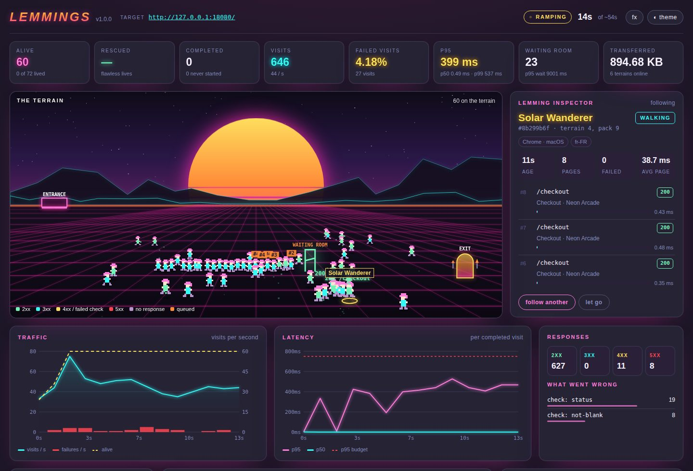

# Lemmings vs Apache JMeter: Git-Native YAML, Go Goroutines & Visual Error Forensics vs. Heavy JVM XML `.jmx` Plans

[](https://github.com/andreimerlescu/lemmings)
[](../../LICENSE)
[](https://go.dev/)

> **TL;DR Verdict:** **Lemmings is the modern, decisively better replacement for Apache JMeter for HTTP websites, web applications, and REST APIs.** While JMeter traps teams in unreviewable multi-thousand-line XML `.jmx` files, heavy OS-thread-per-user JVM memory footprints, fragile external plugin managers, and zero browser rendering or screenshot forensics, **Lemmings v2.0.1** ships as a single `20–23 MB` Apache-2.0 Go binary with zero JVM: clean Git-diffable strict YAML plans (`-plan`) + automatic `5%` rogue crawling, automatic 4-part Chrome DevTools Protocol (CDP) error screenshots & JS console traces, a real-time authenticated Synthwave Admin Triage Portal (`-review`), self-contained HTML/Markdown/JSON reports, and built-in CI gates + `lemmings compare` regression diffs.
>
> ⭐ **Never resolve a 2,000-line `.jmx` XML merge conflict again!** [Star `andreimerlescu/lemmings` on GitHub](https://github.com/andreimerlescu/lemmings) to help more developers discover a cleaner way to load test.

| Quick Decision Summary | **Lemmings (`v2.0.1`)** | **Apache JMeter** |
| --- | --- | --- |
| **Test Format & Git Workflow** | Human- & AI-readable strict `KnownFields(true)` YAML (`-plan`) + zero-code `-crawl` | Verbose XML `.jmx` files edited in a Java Swing GUI (notorious Git merge-conflict nightmare) |
| **Concurrency & Footprint** | Single `20–23 MB` Go binary; lightweight goroutines, bounded memory, zero JVM tuning | Requires JDK + JVM heap (`-Xms`/`-Xmx`); 1 OS thread per virtual user (heavy RAM per VU) |
| **When Something Breaks** | Automatic CDP screenshot + JS console + cookie jar + parsed error body + live Admin Triage Portal | View Results Tree must be **disabled** during load runs to avoid OOM; CLI `.jtl` logs hold zero screenshots or JS logs |
| **Install in 10 Seconds** | `go install github.com/andreimerlescu/lemmings/v2/cmd/lemmings@latest` | Install JDK + download/unzip JMeter archive + install JMeter Plugins Manager |

---

## Side-by-Side Feature Comparison (`Lemmings` vs `JMeter`)

| Capability | Lemmings (`v2.0.1`) | Apache JMeter |
| --- | :---: | :---: |
| Permissive Apache-2.0 open-source license | ✅ | ✅ |
| Single standalone binary (zero JVM / Java Swing / plugins) | ✅ (`20–23 MB` Go binary) | ❌ (requires JDK + JMeter bundle + plugin JARs) |
| Git-friendly, PR-reviewable, AI-authorable test plans | ✅ (strict `KnownFields(true)` YAML) | ❌ (nested XML `.jmx` files) |
| Lightweight concurrency without OS-thread-per-VU RAM bloat | ✅ (Go goroutines + bounded queues) | ❌ (OS thread per virtual user in Thread Group) |
| Zero-script automatic site crawl & organic link navigation | ✅ (`-crawl`, `-navigation links`) | ❌ (every sampler must be built or recorded in GUI) |
| Per-visitor stateful RFC 6265 cookie jars enabled by default | ✅ (`InspectingJar` always active) | ❌ (silently stateless unless you manually add HTTP Cookie Manager) |
| Weighted multi-persona suites + built-in `5%` rogue cohort | ✅ (`plans:` + `-rogue-rate`) | ❌ (manual Thread Groups / Throughput Controllers; no rogue crawler) |
| Automatic `200 OK` blank-page & soft-error detection | ✅ (built-in `not-blank` + `want-*`) | ❌ (must manually add Response Assertion to every sampler) |
| Automatic error screenshots (pure-Go CDP, zero Node.js) | ✅ | ❌ |
| Real-browser Scouts (`-scouts N`) for client-side JS/render crashes | ✅ | ❌ (WebDriver Sampler plugin is heavy & fragile) |
| Safe live web dashboard & error triage *during* load runs | ✅ (160-sprite capped Admin Portal + `-review`) | ❌ (official docs warn: **never run GUI mode for load tests**) |
| Self-contained HTML (inline screenshots), GitHub Markdown & JSON reports | ✅ (all 3 + `.artifacts/` built-in) | ✅ (multi-file HTML dashboard via `-e -o`, no Markdown, no screenshots) |
| CI pass/fail pipeline gates | ✅ (native CLI flags, `exit 2`) | 🟡 (bolted on via assertions + Jenkins/CI plugin or Taurus; bare CLI exits `0`) |
| Built-in CLI baseline regression diff (`lemmings compare`) | ✅ (`lemmings compare`, `exit 2`) | ❌ (requires custom `.jtl` diff scripts or external dashboards) |
| Native virtual waiting-room protocol (Concert queue separation) | ✅ | ❌ |
| Opt-in same-origin static asset tier (`-assets`, isolated from page SLOs) | ✅ | ✅ ("Retrieve All Embedded Resources", skews sampler time) |
| Built-in Prometheus `/metrics` scrape exporter (`24` metrics) | ✅ (`-observe`, zero plugins) | ❌ (requires Backend Listener / Prometheus plugin JAR) |
| Built-in S3 & hardened TLS 1.2+ SMTP report delivery | ✅ (`-save-to s3://...,mailto:...`) | ❌ (external CI scripts required) |
| Security hardened (SSRF dial guard, secret scrubbing, CycloneDX SBOM) | ✅ (`SEC-01`–`SEC-10`) | ❌ |
| Legacy/non-HTTP enterprise protocols (JDBC, LDAP, FTP, JMS, SOAP) | ❌ (HTTP/HTTPS web & API focused) | ✅ (extensive legacy protocol samplers) |
| AI agent plan-authoring runbook (`SKILL.md`) | ✅ | ❌ |

---

## Performance & Real-World Output Side by Side

JMeter's thread-per-user JVM model was designed in an era before Go goroutines, HTTP/2, and modern SPA frontends. Running 400+ concurrent stateful users in JMeter requires careful `-Xmx` heap tuning, disabling GUI listeners (especially `View Results Tree`, which rapidly causes `OutOfMemoryError`), and remembering to add HTTP Cookie Manager + Cache Manager + Header Manager to every Thread Group. Below are **real verified Lemmings runs (`counthis.app` and `toktail.app`)** contrasted against JMeter's documented architecture and failure visibility.

### Real Verified Lemmings Run Data (`396` Stateful Visitors · `3m0s`)

| Metric | Lemmings on `counthis.app` *(Standard Web App)* | Lemmings on `toktail.app` *(Concert Queue + 503 Chaos)* | What JMeter Requires / Captures on These Targets |
| --- | --- | --- | --- |
| **Setup & Memory Footprint** | **1 command, 20–23 MB binary**, `0` dropped lifelogs, zero heap flags | **1 command, 20–23 MB binary**, `0` dropped lifelogs, `0` dropped captures | JDK + `.jmx` XML plan + HTTP Cookie Manager + `HEAP="-Xms1g -Xmx4g"` + 396 OS JVM threads in non-GUI `-n` mode |
| **Visitors & Rescued Score** | `396/396` completed · **`100.0%` rescued** (`384` peak alive) | `396/396` completed · **`89.1%` rescued** (`353/396` flawless, `384` peak alive) | Tracks sampler OK/KO counts in `.jtl` CSV; no per-visitor rescued journey score or clickable notable-user trails |
| **Visits & Throughput** | **`10,831` visits** across `10` auto-crawled routes · `60.2` visits/s avg (**`144` visits/s peak**) · `76.15 MB` | **`3,110` visits** across `4` routes · `17.3` visits/s avg (`77` visits/s peak) · `36.87 MB` | Hits only hardcoded HTTP Samplers in `.jmx`; crawling dynamic links requires complex regex/CSS post-processors |
| **Origin Page Latency** | **p50 `35.8ms`** · p90 `123.8ms` · **p95 `185.4ms`** · p99 `607.8ms` · **TTFB p95 `144.5ms`** (`<= 0.5%` 4096-bin histogram) | **p50 `43.0ms`** · p90 `69.3ms` · **p95 `186.2ms`** · p99 `206.0ms` · **TTFB p95 `156.5ms`** *(isolated from queue wait)* | Generates static HTML stats post-run via `-e -o`; waiting-room loops and embedded resources distort aggregate percentiles unless manually split with Transaction Controllers |
| **Waiting Room & Queueing** | `0` held | **`1,093` held** (`729` admitted, `364` died in line, **`11,685` `/queue/status` polls**, max pos `359`, mean wait `24s`, `3,026` passes) | **Complex `.jmx` While Controller + JSON/Regex Extractors + Constant Timers** required by hand; easy to create infinite loops or survivorship bias |
| **Error Forensics & Visual Receipts** | `0` errors · `0` dropped lifelogs | `313` HTTP `503`s (`11.4%`) → **`12` deduplicated 4-part artifacts** + **`12` Chrome CDP screenshots** (`301` deduped, `0` dropped) + JS console `404` on `/favicon.ico` | `.jtl` CSV logs `503,Service Unavailable` × 313 (if View Results Tree is properly disabled). **Zero screenshots, zero cookie jar table, zero JS console output, zero live triage UI** |

### Runtime & Architecture Footprint Comparison

| Dimension | Lemmings (`v2.0.1`) | Apache JMeter |
| --- | --- | --- |
| **Concurrency Model** | Lightweight Go goroutines (few KB stack each); `32 KiB` fixed-size 4096-bin histogram | 1 OS thread per virtual user (~512 KB–1 MB stack + JVM object overhead each) |
| **Safe Live Inspection** | Scale-proof Admin Portal caps stage at `160` sprites & batches SSE at `5 fps`—identical browser CPU for 10 or 100,000 lemmings | JMeter Swing GUI freezes/OOMs under load; CLI `-n` mode gives only plain stdout summary lines |
| **CI Pipeline Exit Codes** | Deterministic: `0` pass, `1` config/plan error, `2` SLO gate or `compare` regression breach, `130` interrupted | Bare JMeter CLI exits **`0`** even on 100% errors; failing a build requires assertions + a Jenkins Performance Plugin, Taurus, or custom `.jtl` parser |
| **Report Footprint** | Single self-contained HTML + GitHub-ready `.md` + lean `.json` (`schema 2.0`) | Large raw `.jtl` CSV + multi-file HTML directory requiring static web serving |

### Scale-Proof Live Triage vs. "Don't Use GUI Mode for Load Testing"

Every JMeter user learns the hard way that JMeter's Swing GUI cannot be used during real load tests. Lemmings solves live observability by architecture: its embedded Admin Portal runs safely on loopback alongside high-scale Go load generation, streaming 12 deduplicated Chrome CDP screenshots, cookie jar states, visitor trails, extracted HTML error bodies, and JS console errors (`favicon.ico` `404`) during the `toktail.app` run with zero dropped lifelogs:

| Live Admin Triage Portal (`http://localhost:4000`) | Self-Contained HTML Report with Embedded Screenshots |
| :---: | :---: |
|  |  |

---

## Conventions Translation: How JMeter Elements Map to Lemmings

Every JMeter GUI tree element translates into a crisp, Git-reviewable Lemmings CLI flag or strict YAML field:

| Apache JMeter Element / CLI Flag | Lemmings (`v2.0.1`) Equivalent | Why Lemmings Is Better |
| --- | --- | --- |
| **Test Plan (`.jmx` XML)** | Strict YAML file or directory (`-plan ./plans/`) | Human-readable, clean Git diffs, validated in ms via `KnownFields(true)` + `-dry-run` |
| **HTTP Request Defaults** | `-hit https://staging.example.com/` | Enforces strict `SameOrigin` + dial-time SSRF guard automatically |
| **Thread Group** (`Threads`, `Ramp-up`, `Duration`) | `-terrain`, `-pack`, `-limit`, `-ramp`, `-ramp-shape`, `-until` | Lightweight goroutines + `linear`/`fibonacci`/`step` curves + zero JVM heap tuning |
| **HTTP Cookie Manager** | Built-in `InspectingJar` (always on!) + `with-cookies` / `want-cookies` | Impossible to forget; enforces RFC 6265 scoping and tracks cookie health in forensics |
| **HTTP Header Manager** | Per-step `with-headers` with `${ENV_VAR}` | Scoped cleanly per step (no accidental header leaks) + `SEC-10` secret redaction |
| **HTTP Request Sampler** | YAML `PlanItem` (`name`, `path`, `method`, `with-body` / `body`) | Supports `GET`/`POST`/`PUT`/`PATCH`/`DELETE`/`HEAD`/`OPTIONS` with auto form/JSON encoding |
| **Response Assertion** | `want-status`, `want-body`, `want-headers`, `want-cookies`, `want-title`, `want-selectors` | Plus automatic `not-blank` check + automatic 4-part CDP forensics on failure |
| **Uniform Random / Constant Timer** | `-think-min 300ms -think-max 1200ms` or per-step `chill: 1s` | Realistic human pauses enabled by default; overrideable per step |
| **Throughput Controller (traffic split)** | Multi-persona `plans:` with integer `weight` + `5%` `-rogue-rate` | Exact deterministic weighting (`slot = planCohortIndex % TotalWeight`) |
| `jmeter -n -t plan.jmx -l out.jtl -e -o report/` | `lemmings -hit ... -plan plan.yaml -tty=false -save-to ./reports` | Produces HTML, GitHub Markdown, JSON (`schema 2.0`), screenshots, and enforces CI exit code `2` |

### Side-by-Side Example: Login & Protected Page Test

**Apache JMeter (`.jmx` snippet — typically 150–400+ lines of brittle XML for just 2 HTTP requests, plus manually remembering Cookie Manager & Response Assertions):**
```xml
<HTTPSamplerProxy testname="POST /login" enabled="true">
  <stringProp name="HTTPSampler.path">/login</stringProp>
  <stringProp name="HTTPSampler.method">POST</stringProp>
  <elementProp name="HTTPsampler.Arguments" elementType="Arguments">
    <collectionProp name="Arguments.arguments">
      <elementProp name="username" elementType="HTTPArgument">
        <stringProp name="Argument.name">username</stringProp>
        <stringProp name="Argument.value">${__P(DEMO_USER)}</stringProp>
      </elementProp>
      <!-- ... plus CookieManager, HeaderManager, ResponseAssertion, ThreadGroup XML ... -->
    </collectionProp>
  </elementProp>
</HTTPSamplerProxy>
```
```bash
# JMeter CLI: exits 0 even if every request returns HTTP 500!
jmeter -n -t login-plan.jmx -JDEMO_USER="$DEMO_USER" -JDEMO_PASS="$DEMO_PASS" \
  -l results.jtl -e -o html-report/
```

**Lemmings (35 Lines of Clean Strict YAML — Zero XML, Auto Cookie Jar, Auto CDP Screenshots, Deterministic Exit Code `2`):**

Save as `login-plan.yaml`:
```yaml
name: returning-customer
weight: 10
stop-on-fail: true
loop: false
plan:
  - name: login-page
    path: /login
    method: GET
    chill: 500ms
    want-status: 200
    want-selectors: ["form"]
  - name: authenticate
    path: /login
    method: POST
    chill: 1s
    with-body:
      - key: username
        value: "${DEMO_USER}"
      - key: password
        value: "${DEMO_PASS}"
    want-status: 200
    want-cookies:
      - name: session_id
    want-body:
      - contains: Dashboard
        not-contains: Invalid credentials
  - name: view-profile
    path: /account/profile
    method: GET
    want-status: 200
    want-content-type: text/html
    want-selectors: ["main", "#profile-details"]
    want-cookies:
      - name: session_id
    want-body:
      - contains: Account Settings
        not-contains: Something went wrong
```

Validate with `-dry-run`, then execute with CI gates and a Browser Scout:
```bash
export DEMO_USER="player1"
export DEMO_PASS="staging-pass"
lemmings -hit https://staging.example.com/ -plan login-plan.yaml -dry-run

lemmings \
  -hit https://staging.example.com/ \
  -plan login-plan.yaml \
  -terrain 6 -pack 15 -limit 60 -until 60s -ramp 15s \
  -scouts 2 \
  -min-plan-pass-rate 0.99 -max-failure-rate 0.01 -p95-budget 750ms \
  -tty=false -unique-report -save-to ./reports
```

---

## Apache JMeter Gotchas & Pitfalls — Solved Out of the Box by Lemmings

1. **The Unreviewable `.jmx` XML Merge-Conflict Nightmare**
   - **JMeter pitfall:** Opening a `.jmx` file in the JMeter GUI and clicking one checkbox often reorders XML tags across hundreds of lines—making Git code reviews miserable and causing constant merge conflicts across teammates.
   - **How Lemmings solves it:** Strict, concise YAML (`KnownFields(true)`) that supports either a single `plans:` bundle or a **directory of modular YAML files** (`-plan ./plans/` loaded in lexicographic order like `01-anonymous.yaml`, `02-checkout.yaml`) so teams own personas independently with zero merge conflicts.
2. **Bare CLI Exits `0` Without Bolted-On Pipeline Plugins**
   - **JMeter pitfall:** You can gate a pipeline with JMeter assertions plus a Jenkins Performance Plugin fail-build step or Taurus (`bzt`), but bare `jmeter -n -t test.jmx` exits `0` even if 100% of requests return HTTP `500`—forcing extra plugins or fragile `.jtl` parsers in GitHub Actions and GitLab CI.
   - **How Lemmings solves it:** Native CLI CI gates (`-max-failure-rate`, `-p95-budget`, `-min-plan-pass-rate`, `-min-queue-held`, `-max-queue-wait`) return deterministic exit code `2` out of the box with zero plugins, alongside `lemmings compare` for automated release regression gating.
3. **Forgetting to Add an HTTP Cookie Manager Silently Breaks Sessions**
   - **JMeter pitfall:** By default, JMeter Thread Groups discard `Set-Cookie` headers unless you explicitly remember to add an `HTTP Cookie Manager` element—silently breaking login flows and generating misleading `401`/`302` loops.
   - **How Lemmings solves it:** Every lemming carries an RFC 6265-compliant `InspectingJar` automatically from request #1, with cookie health and HMAC fingerprints recorded in every forensic artifact.
4. **JVM `OutOfMemoryError` & "Never Run GUI Mode for Load Tests"**
   - **JMeter pitfall:** Leaving `View Results Tree` enabled or running moderate concurrency in the Swing GUI exhausts JVM heap, freezes the UI, and corrupts latency numbers; even CLI mode requires manual `-Xmx` sizing for OS threads.
   - **How Lemmings solves it:** Lightweight Go goroutines, bounded memory (`32 KiB` histogram, `256`-cookie cap, `160`-sprite stage cap, `5 fps` SSE batching), and non-blocking O(1) forensics dedup let you watch the live Admin Portal safely *during* real load tests without ever threatening stability.
5. **Passing Secrets via `-JDEMO_PASS=...` Exposes Credentials in `ps aux`**
   - **JMeter pitfall:** Standard JMeter CLI tutorials pass secrets via `-J` system properties on the command line, exposing them in process tables and CI command logs, while `.jtl` XML dumps can record sensitive response bodies/headers unredacted.
   - **How Lemmings solves it:** Reads plan secrets exclusively from fail-closed `${ENV_VAR}` placeholders (never CLI flags), tags all `with-*`/`body` and raw cookies `json:"-"` (`SEC-10`), enforces `0600` permissions on SMTP password files and trace JSONL (`SEC-01`/`SEC-06`), and scrubs extracted error bodies & JS console logs.
6. **Zero Visual Screenshots or Real Browser JS Diagnostics**
   - **JMeter pitfall:** JMeter cannot render broken error pages or catch uncaught JavaScript crashes on `200 OK` SPA pages without bolting on heavyweight, flaky Selenium WebDriver Sampler plugins.
   - **How Lemmings solves it:** Pure-Go Chrome DevTools Protocol capture (zero Node.js, zero Selenium) automatically captures screenshots and JS console traces on failing `GET` visits, while `-scouts N` runs real headless Chromium visitors alongside the HTTP swarm.

---

## Common Load-Testing Problems & How Lemmings Resolves Them

| Real-World Load Testing Problem | Why It Hurts in JMeter | How Lemmings Solves It Out of the Box |
| --- | --- | --- |
| **Developers refuse to touch load tests because of GUI/XML friction** | Only a dedicated QA specialist knows how to edit `.jmx` trees safely. | Clean YAML plans (10 ready-to-adapt blueprints in [`docs/plans.md`](../plans.md)) + [`SKILL.md`](../../SKILL.md) let any developer or AI coding agent author & validate suites in minutes. |
| **"CI showed 300 `503`s in `.jtl`, but View Results Tree was off—what broke?"** | You must disable response-body capture at scale to prevent JMeter OOM. | Bounded, deduplicated (`-capture-max 50`, `-capture-per-error 3`) 4-part Error Forensics captures screenshots, JS console traces, cookie jars, and parsed error bodies safely at scale with `0` OOM risk. |
| **Static assets (`Retrieve All Embedded Resources`) distorting page latency** | JMeter adds embedded CSS/JS/image fetch time into parent sampler latency unless configured carefully. | Opt-in `-assets -assets-per-page 8` uses a per-lemming 2,048-entry cache and isolates all asset telemetry in `AssetReport`, keeping `-p95-budget` purely focused on page SLOs. |
| **Virtual waiting rooms breaking Thread Groups** | Queue polling requires brittle nested While Controllers & custom extractors. | Native Concert waiting-room protocol separates origin page latency (`186.2ms` p95 on `toktail.app`) from queue wait (`24s` mean), prevents survivorship bias (`v2.0.1`), and gates queues via `-min-queue-held` / `-max-queue-wait`. |
| **No simple way to diff release B against release A in CI** | Comparing two `.jtl` CSVs or HTML dashboards requires custom scripts or external dashboards. | `lemmings compare -max-p95-delta 100ms -max-failure-delta 0.01 baseline.json candidate.json` runs in milliseconds, exits `2` on regression, and highlights new (`+`) vs. resolved (`-`) error signatures. |

---

## Getting Started with Load Testing: Frequently Asked Questions

### How do I start load testing with Lemmings instead of installing JMeter and Java?
1. Install the single `20–23 MB` binary: `go install github.com/andreimerlescu/lemmings/v2/cmd/lemmings@latest`.
2. Experience a full visual forensics run in 60 seconds using the bundled local demo (`make demo` + `make run-forensics`) and open `http://localhost:4000/#token=...`.
3. Validate your own staging URL safely with `lemmings -hit https://staging.example.com/ -crawl -dry-run` (zero load sent).
4. Run a small crawled test with `-review`, then convert your core user funnels into modular YAML files inside `./plans/` (`-plan ./plans/`).

### How do I migrate an existing JMeter `.jmx` test plan to Lemmings?
Identify the Thread Groups and HTTP Samplers in your `.jmx` file: turn each Thread Group into a YAML persona under `./plans/` (assigning `weight` proportionally), replace HTTP Samplers with ordered `plan:` steps (`method`, `path`, `with-headers`, `with-body`), drop the HTTP Cookie Manager boilerplate (Lemmings handles RFC 6265 cookies automatically), turn Response Assertions into `want-status`/`want-body`/`want-headers`/`want-cookies`/`want-selectors`, and move your pass/fail criteria into `-max-failure-rate`, `-p95-budget`, and `-min-plan-pass-rate`. Validate immediately with `-dry-run`.

### Can I run Lemmings cleanly in GitHub Actions or GitLab CI without Java or Docker bloat?
Yes—a single 20 MB binary runs natively on Linux/macOS/Windows (`amd64`/`arm64`), pairs cleanly with a loopback `chromedp/headless-shell` CI service via `-cdp-url http://127.0.0.1:9222`, exits `2` automatically on gate failure, uploads self-contained HTML + Markdown + `.artifacts/` screenshots, and runs `lemmings compare` against your baseline JSON. Complete GitHub Actions and GitLab CI recipes live in [Reports, Delivery & CI Gates](../reports-and-ci-gates.md).

### Why is Lemmings the better default choice over JMeter for web apps and APIs?
Because Lemmings trades 1990s Java Swing + XML `.jmx` + OS-thread JVM overhead for a zero-dependency Go binary, Git-native strict YAML, automatic Chrome CDP error screenshots & JS console forensics, a safe real-time Admin Triage Portal, native CI exit codes, and `lemmings compare` regression diffs—all under the same permissive Apache-2.0 license.

> **When JMeter still fits:** If your enterprise QA team must load-test legacy or non-HTTP protocols directly—such as **JDBC** database queries, **LDAP** directories, **FTP/SFTP**, **JMS**, **SOAP/WS-Security**, or **TCP** custom samplers—and already has an established JMeter plugin investment for those protocols, JMeter remains the Swiss Army knife for legacy enterprise transports. For modern HTTP/HTTPS websites, web applications, and REST APIs, Lemmings is dramatically faster to author, lighter to run, and infinitely easier to debug.

---

## Try Lemmings in 60 Seconds

```bash
# Single 20–23 MB Apache-2.0 Go binary — zero JDK, zero XML .jmx, zero OOM GUI
go install github.com/andreimerlescu/lemmings/v2/cmd/lemmings@latest

# Pre-flight validation (zero load sent)
lemmings -hit https://staging.example.com/ -plan examples/plans/neon-arcade-personas.yaml -dry-run

# Run a multi-persona swarm with live Admin Triage Portal, Browser Scouts & CI gates
lemmings -hit https://staging.example.com/ \
  -plan examples/plans/neon-arcade-personas.yaml \
  -terrain 8 -pack 15 -limit 80 -until 60s -ramp 15s -ramp-shape fibonacci \
  -scouts 2 -min-plan-pass-rate 0.99 -max-failure-rate 0.01 -p95-budget 750ms \
  -review -unique-report -save-to ./reports
```

**Using an AI coding agent?** Point it at [`SKILL.md`](../../SKILL.md) to automatically inspect your site/codebase and generate a clean 10-persona YAML suite (zero XML!).

---

⭐ **Leave `.jmx` merge conflicts and blind `.jtl` CSVs in the past — [star `andreimerlescu/lemmings` on GitHub](https://github.com/andreimerlescu/lemmings)!**

**More Comparisons:** [All Tools Hub](./README.md) · [vs Apache Benchmark (`ab`)](./lemmings-vs-ab.md) · [vs Bombardier](./lemmings-vs-bombardier.md) · [vs NBomber](./lemmings-vs-nbomber.md) · [vs k6](./lemmings-vs-k6.md) · [vs Gatling](./lemmings-vs-gatling.md) · [vs Locust](./lemmings-vs-locust.md)
