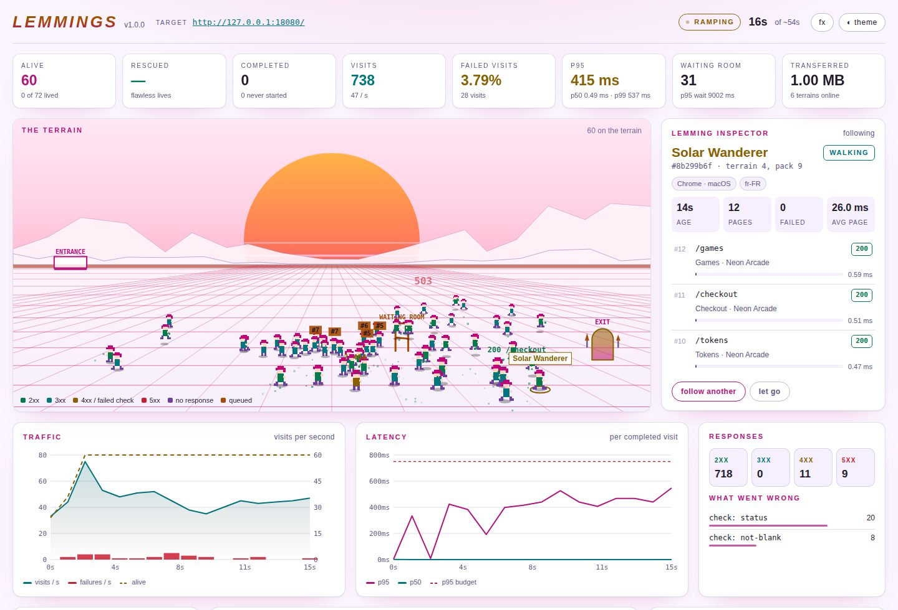

# Admin Portal & Live Triage Guide

Every Lemmings run launches an authenticated, self-contained **Admin Portal** on loopback (`http://127.0.0.1:4000` by default, configurable via `-dashboard-port`). No external fonts, CDNs, or JavaScript libraries are loaded — everything is embedded into the single Go binary with a strict hash-based Content Security Policy.

| Dark Mode (Synthwave '84) | Light Mode |
| :---: | :---: |
|  |  |

---

## Signing In

At startup, Lemmings generates a cryptographically random 256-bit boot token and prints a one-click URL:

```text
  dashboard:        http://localhost:4000/#token=<64-hex-chars>
  token:            <64-hex-chars>
```

- Because the token is placed in the URL **fragment (`#token=...`)**, browsers never transmit it in HTTP request logs or `Referer` headers.
- The login page reads the fragment, submits it via `POST /auth`, immediately scrubs the fragment from browser history (`history.replaceState`), and exchanges it for an `HttpOnly`, `SameSite=Strict`, HMAC-SHA256 signed session cookie.
- You can also open `http://localhost:4000/` and paste the printed token manually.

---

## Live Stage & Telemetry Panels

- **KPI Strip:** Live `alive` (`started` of planned total), `rescued %`, `completed` (`started` / `unborn`), `visits` + requests/sec, `failed visits`, `p95`/`p50`/`p99` page latency, `assets` (requests, bytes, p95, `403` denials when `-assets` is active), `waiting room` (held, admitted, queue polls, p95 wait, expired/denied), `bans / passes` (`429`/`403` bans and Concert `concert_admit` passes), `scouts` (visits, live scouts, failures), `error artifacts`, and `transferred` bytes.
- **Data Integrity Banner:** Automatically alerts in the header whenever `dropped_logs > 0` or `forensics.dropped_queue > 0` under backpressure.
- **Animated Lemmings Stage:** Up to 160 active visitors drop from the entrance hatch onto the synthwave terrain and visually react to every page (`2xx` hop, `3xx` bounce, `4xx`/check stumble, `5xx` knockback, transport glitch, waiting room queue badge, exit hatch).
- **Plan Execution Section (`#plan-section`):** Dedicated card section below the stage (shown when `-plan` is active) displaying plan cohort pass rate, passed/failed counts, rogue cohort count, and per-persona progress.
- **Follow a Lemming:** Click any lemming on the stage (or press `f`) to open the **Lemming Inspector**, showing its sequential `#Number`, name, assigned persona/plan (or rogue mode), browser persona, language, every visited path, status, TTFB, redirect hops, queue wait, exit reason (including `plan-failed`), and direct links to any captured error artifact.
- **Live Charts & Terrain Map:** Real-time traffic/failure/alive/latency curves, per-terrain ramp grid, busiest paths table, and a rate-limited **Happenings** event feed.

### Keyboard Shortcuts

| Key | Action |
| --- | --- |
| `t` | Toggle dark / light Synthwave '84 theme (follows system preference by default). |
| `x` | Toggle canvas/motion effects (honors `prefers-reduced-motion`). |
| `f` | Follow a random active lemming in the inspector. |
| `Esc` | Close the active Artifact Inspector Modal or Lemming Inspector. |

---

## Live Error Forensics Gallery

As soon as any lemming or browser Scout triggers an error capture, the new artifact streams into the **Error Forensics Gallery** over Server-Sent Events (`artifact` event) without reloading the page:

- **Live Filter Tabs:** `All`, `Unreviewed`, `5xx`, `4xx`, `JS Errors`, and `Check Failures`.
- **Instant Search:** Filter cards by URL path, error headline, lemming `#Number`, or lemming name.
- **Live Triage Counters:** Tracks `captured`, `unreviewed`, `bug`, `flaky`, `expected`, and `ignored` counts in real time.
- **Direct Cross-Links:** Click an artifact badge inside the **Happenings** feed or **Lemming Inspector** to jump straight to that artifact's inspection modal.

---

## 4-Panel Artifact Inspector Modal

Clicking any gallery card opens the 4-panel forensic modal backed by `GET /api/artifacts/{id}` and `GET /api/artifacts/{id}/image`:

1. **Screenshot Tab:** Full-resolution captured screenshot (click to zoom/fit), viewport dimensions, capture mode (`cdp-replay`, `cdp-scout`, or `http-only` — including failed non-GET / request-body plan steps where CDP replay is intentionally skipped), and SHA-256 checksum.
2. **Session & Cookie Jar Tab:** Lemming `#Number`, ID, friendly name, terrain/pack, User-Agent, persona, language, active plan & step (or rogue navigation), `Referer`, navigation breadcrumb trail, and the complete **Cookie Jar table** (name, domain/path, flags, expiry/health, value byte size, HMAC fingerprint — plus raw cookie value *only* if `-reveal-session-cookies` was passed). Plan `with-cookies`, `with-headers`, `with-body`, and `body` request inputs are never exposed in portal APIs (`json:"-"`).
3. **Extracted Error & Body Tab:** Detected format (`html`/`json`/`xml`/`text`), summary headline, error code, request ID, extracted detail bullets, stack trace block, allowlisted diagnostic response headers, and secret-scrubbed body excerpt.
4. **JS Console Tab:** Filterable table of all `exception`, `error`, `warning`, `network`, and `log` entries captured from Chromium with source file, line/column, and stack traces.

---

## Admin Triage & Post-Run `-review` Mode

At the top of the Artifact Inspector Modal, click any triage button (`Bug`, `Flaky`, `Expected`, `Ignored`, or `Unreviewed`) and optionally enter a short note (up to 500 characters). Saving sends `POST /api/artifacts/{id}/review`:

- Persists your verdict and note immediately into the forensics `Store`.
- Broadcasts an `artifact_review` SSE update to all open portal tabs.
- Embeds your triage badge and note directly into the final **HTML**, **Markdown**, and **JSON** reports.

### Holding the Portal Open with `-review`

Normally, Lemmings writes its reports and shuts down the portal as soon as the swarm ends. Pass **`-review`** when you want time to inspect screenshots and tag bugs *before* the final report is generated:

```bash
lemmings -hit http://127.0.0.1:8080/ \
  -terrain 4 -pack 6 -until 30s -ramp 5s \
  -plan examples/plans/forensics-demo.yaml \
  -scouts 1 -review -save-to ./reports
```

When the swarm finishes:
1. All in-flight screenshot captures drain cleanly.
2. The portal switches to the **`reviewing`** phase and displays a prominent banner with a **Finalize & Write Report →** button.
3. Inspect every captured screenshot, add triage tags and notes, and click **Finalize & Write Report** (or press `Ctrl-C` in the terminal) to render and deliver all reports with your verdicts baked in.

---

## Portal API Reference (Authenticated Loopback Only)

| Endpoint | Method | Purpose |
| --- | --- | --- |
| `/` | `GET` | Login page (unauthenticated) or Admin Portal HTML (authenticated). |
| `/auth` | `POST` | Validates boot token (`application/x-www-form-urlencoded`), sets HMAC session cookie, rate-limited (`429` after 15 failures/min per remote IP from `r.RemoteAddr` ignoring `X-Forwarded-For`, capped at 1024 tracked IPs, plus a 60/min global ceiling). |
| `/events` | `GET` | Server-Sent Events stream (`frame`, `metrics`, `artifact`, `artifact_review`). |
| `/metrics` | `GET` | Live JSON counter snapshot (`alive`, `lemmings_started`, `completed`, `failed`, `plan_passed`, `plan_failed`, `rogue_lemmings`, `total_visits`, `asset_requests`, `asset_failed`, `asset_denied_403`, `asset_bytes`, `waiting_room`, `queue_polls`, `bans_429`, `bans_403`, `scout_visits`, `scout_failures`, status classes, drop counters). |
| `/replay` | `GET` | Recent ring-buffer event history for cold-join browser tabs. |
| `/api/state` | `GET` | Complete stage snapshot, feed, metrics, and forensics stats. |
| `/api/lemming?id=...` | `GET` | Full visit-by-visit life log for one lemming. |
| `/api/artifacts` | `GET` | Filtered list of captured artifact summaries (`?status=&kind=&q=`). |
| `/api/artifacts/{id}` | `GET` | Full 4-part artifact detail DTO. |
| `/api/artifacts/{id}/image` | `GET` | Raw JPEG/PNG screenshot bytes (`nosniff`, `CSP: default-src 'none'`). |
| `/api/artifacts/{id}/review` | `POST` | Update triage verdict & note (`Content-Type: application/json`, CSRF-protected). |
| `/api/finalize` | `POST` | Release `-review` hold and write final reports (`Content-Type: application/json`, CSRF-protected). |
